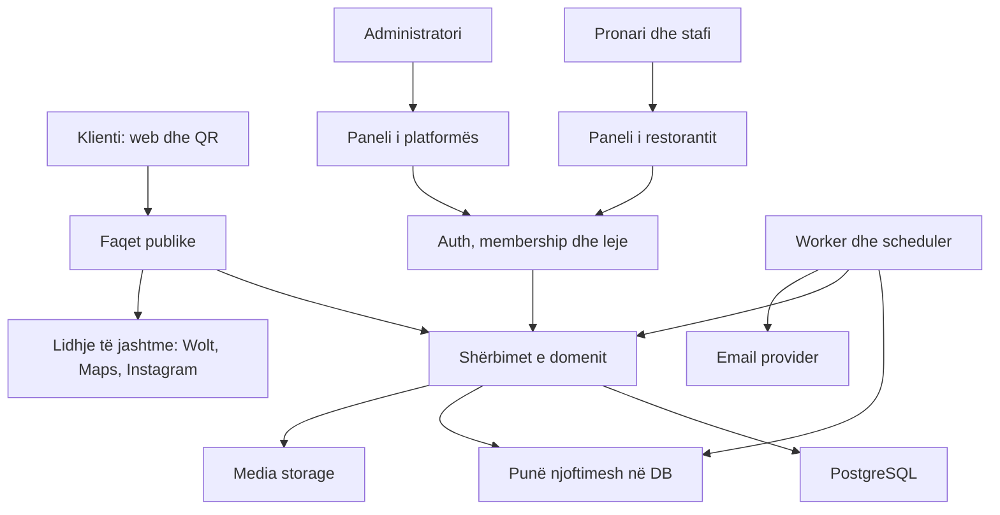
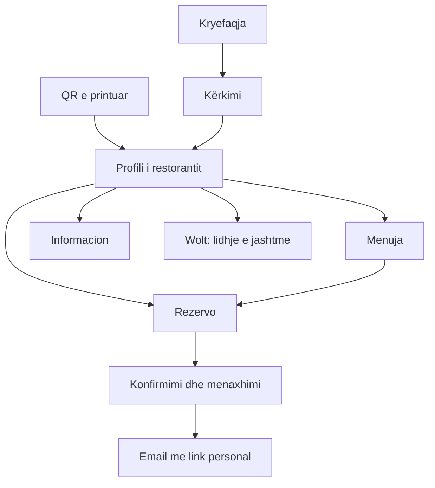

# OnlineMenu — Plan ndërtimi, arkitekturë, hartë lidhjesh dhe prompte

> Për agjentin implementues: përdor `executing-plans` nëse ky skill është i disponueshëm; ekzekuto një fazë në herë. Mos nis subagjentë pa kërkesë të përdoruesit. Ky është masterplan dhe specifikim i propozuar për shqyrtim, jo provë se funksionet janë implementuar. Përpara çdo faze përgatit planin teknik të saj me skedarë dhe teste konkrete, duke kontrolluar gjendjen aktuale të repos.

**Goal:** Një platformë ku restorantet menaxhojnë menunë QR dhe rezervimet në një panel, ndërsa klientët zbulojnë restorante ose hapin direkt profilin e tyre nga QR-ja.

**Architecture:** Një aplikacion Next.js me module të ndara për identitetin, restorantet, menunë, booking-un, abonimet dhe njoftimet. Një PostgreSQL; çdo e dhënë biznesi lidhet me restorantin. Punët e planifikuara përdorin të njëjtat shërbime të domenit si aplikacioni.

**Tech Stack:** TypeScript, Next.js/React, Prisma/PostgreSQL, komponentë React, CSS tokens dhe Tailwind i harmonizuar. Versionet përfundimtare fiksohen pas auditimit të përputhshmërisë; nuk përzihen major versions nga dy repo-t.

**Spec:** Seksionet 1–10 të këtij dokumenti janë specifikimi; seksionet 11–15 janë plani dhe dorëzimi për ekzekutim.

Data: 23 tetor 2026. Burime të shqyrtuara: `onlinemenu.al` commit `07a9b39`; `restorant` commit `892d287`. Gjendja duhet kontrolluar sërish kur nis implementimi. Nuk janë kryer build/teste të këtyre repo-ve gjatë analizës. Asnjë shkrim në DB live ose deploy nuk është bërë.

## Global Constraints

- QR-ja hap profilin e restorantit; menuja, Wolt dhe rezervimi hapen prej atij profili.
- Wolt është vetëm lidhje e jashtme opsionale, jo integrim porosish ose pagesash.
- Një restorant nuk lexon ose ndryshon të dhënat e një tjetri.
- Autoriteti për rezervimin është transaksioni në server, jo slot-i i shfaqur në UI.
- Ruaj URL-të QR ekzistuese dhe mos ndrysho slug-un pa një mekanizëm alias-esh.
- Mos prek instalimin live të Gjeçaj gjatë zhvillimit; zhvillim/test/staging me DB të ndara.
- Asnjë review, vlerësim, statistike ose disponueshmëri e sajuar në prodhim.
- Dizajni: sfond krem, karta të rrumbullakosura, konture delikate, hije të buta dhe butona jeshilë; i njëjtë në të gjitha modulet.
- Për versionin e parë: AL/EN, monedhë ALL për menunë shqiptare, timezone Europe/Tirane. Çmimet ekzistuese nuk shumëzohen ose konvertohen në heshtje.
- Përfundimi i një faze kërkon prova nga komandat e ekzekutuara, jo vetëm deklarimin e agjentit.

## Review Focus

1. ID, slug ose parent ID i restorantit B i dërguar nga përdoruesi A: refuzim pa rrjedhje të dhënash.
2. Dy rezervime në të njëjtën tavolinë, përfshirë orare të ndryshme që mbivendosen: vetëm një pranohet.
3. Abonimi skadon ose stafi humb akses gjatë një sesioni ekzistues: autorizimi rifreskohet në server.
4. QR e vjetër, ndryshim emri dhe kthim nga Wolt: adresa funksionale dhe identitet i saktë i restorantit.
5. DST, email që dështon pas konfirmimit dhe cron i përsëritur: ora e saktë dhe pa rezervime/njoftime të dyfishta nga retry-t e zakonshme.

---

## 1. Çfarë ndërtojmë dhe çfarë nuk përfshihet

### Versioni i parë i plotë

- Platformë publike: kryefaqe, kërkim, profil restoranti, menu, informacion dhe rezervim.
- QR e qëndrueshme që hap restorantin përkatës.
- Panel restoranti: menu, degustim, branding, profil, lidhje, QR, rezervime, klientë, tavolina, zona, plan salle, orare, staf, abonim dhe statistika bazë.
- Panel platforme: restorante, paketa/aktivizime modulesh, përdorues, shënime pagesash dhe audit i veprimeve.
- Konfirmime/anulime/riplanifikime me email, kujtesa dhe raport ditor.
- Paketat Menu, Rezervime dhe Të dyja: të drejta modulesh të ndara. Pa çmime të shpikura ose checkout abonimi të paracaktuar.

### Më vonë

Porosi brenda platformës, pagesa ushqimi, fiskalizim, integrim Wolt API, aplikacione native, komisione marketplace, reviews të klientëve, lista të preferuarash, login i klientëve, zinxhirë me hierarki organizative, domene custom dhe përkthim automatik në shumë gjuhë. Ikonat e këtyre funksioneve në mockup nuk i bëjnë kërkesa të versionit të parë. Hartë interaktive në rezultatet e kërkimit mund të vijë pas listës funksionale; adresa dhe lidhja e hartës në profil janë pjesë e versionit të parë.

## 2. Çfarë ruajmë nga kodi

| Burimi | Ruajmë/përshtatim | Kujdes |
|---|---|---|
| onlinemenu.al | User/Restaurant, menu CRUD, branding, upload, QR, abonimet manuale | Membership, zgjedhja e restorantit aktiv dhe rolet kërkojnë zgjerim |
| onlinemenu.al | AL/EN dhe menu publike nga DB | Paneli i degustimit/analitikës nuk është i plotë; disa fusha nuk dalin publikisht |
| restorant | availability, transaksione, tavolina, zona, kombinime, kufij slot-esh | Aktualisht single-restaurant; nevojitet tenant context në çdo rrugë |
| restorant | rezervime, walk-in, status, riplanifikim, anulim | Auth-i global admin nuk transferohet si mekanizëm i platformës |
| restorant | email, reminders, daily digest, teste | Identitet, abonim, marrës dhe deduplikim sipas restorantit |
| restorant | floor editor dhe layout | Përshtatje UI me design system-in dhe validim tenant-i |

Repo kryesore e propozuar: `onlinemenu.al`. `restorant` lexohet si burim dhe mbahet i pandryshuar. Nëse auditimi i përputhshmërisë zbulon kosto më të ulët për një bazë tjetër, shkruaj një ADR me prova para se të ndryshosh vendimin. Mos bëj merge mekanik të historive, skemave ose lockfiles.

## 3. Arkitektura logjike



Lidhjet Wolt/Maps/Instagram hapen nga shfletuesi. Serveri nuk merr menunë ose porositë nga Wolt. Analitika mat klikimin dalës, jo numrin e porosive apo rezervimeve në Wolt.

### Module dhe përgjegjësi

| Moduli | Përgjegjësia | Nuk duhet të bëjë |
|---|---|---|
| identity | Login, sesione, rikthim password-i | Të caktojë akses vetëm nga restaurantId i klientit |
| restaurants | Profili, slug/alias, publikimi, lidhjet | Të ruajë sërish profil të dytë te booking settings |
| memberships | Pronari/stafi, role, restoranti aktiv | Të mbështetet te një JWT i vjetër për leje të revokuara |
| menu | Kategori, artikuj, alergjenë, përkthime, orare menuje | Të implementojë porosi ushqimi |
| booking | Disponueshmëri, kapacitet, rezervim, tavolina dhe status | Të dërgojë email brenda transaksionit |
| subscriptions | Aktivizim i moduleve dhe afatet | Të fshijë rezervime kur skadon abonimi |
| notifications | Queue, retry, templates, kujtesa | Të përdorë logon/email-in e restorantit tjetër |
| analytics | Evente dhe agregime reale | Të paraqesë klikime Wolt si porosi |
| administration | Menaxhim platforme dhe audit | Të përdorë rrugë owner pa kontroll të rolit |

### Struktura e propozuar e kodit

```text
src/app/                       # route handlers dhe page composition
src/components/ui/             # komponentë të përbashkët, tokens, dialogs
src/modules/identity/          # auth dhe sesione
src/modules/restaurants/       # public-profile, settings, external-links
src/modules/memberships/       # access-context dhe permissions
src/modules/menu/              # schemas, queries, service, components
src/modules/booking/           # availability, reservations, floor, policies
src/modules/subscriptions/     # entitlements dhe administrim
src/modules/notifications/     # templates, enqueue, worker
src/modules/analytics/         # events dhe raporte
src/modules/admin/             # platform operations dhe audit
src/lib/db.ts                  # Prisma client i përbashkët
prisma/schema.prisma
prisma/migrations/
tests/unit/
tests/integration/
tests/e2e/
docs/architecture/
docs/superpowers/specs/
docs/superpowers/plans/
docs/IMPLEMENTATION-STATUS.md
```

Kjo është struktura e synuar. Zhvendos skedarët gradualisht bashkë me testet; mos bëj refaktorim të të gjithë repos si hap i vetëm.

## 4. Harta e faqeve publike dhe çdo veprimi kryesor

Adresat janë relative ndaj domenit të platformës. `slug` identifikon restorantin; ID-ja e brendshme nuk merret si provë autorizimi.

| Faqja | URL | Hyrja | Lidhjet/veprimet dalëse |
|---|---|---|---|
| Kryefaqja | `/` | Logo/Google/link direkt | Kërko → `/restaurants?...`; kartë → profil; Për restorantet; Hyr |
| Kërkimi | `/restaurants` | Kryefaqja/menu navigimi | Filtra në query string; kartë → profil; slot → rezervim i atij restoranti |
| Profili | `/restaurants/[slug]` | QR/kërkim/link direkt | Menuja, Informacion, Rezervo, Wolt, telefon, hartë, Instagram |
| Menuja | `/restaurants/[slug]/menu` | Shiko menunë | Kërkim/kategori/gjuhë; profil; informacion; rezervim; Wolt opsional |
| Informacioni | `/restaurants/[slug]/info` | Profili/navigation mobile | Maps, telefon, Instagram, Wolt opsional, rezervim |
| Rezervimi | `/restaurants/[slug]/reserve` | Profil/menu/slot kërkimi | Data/persona/ora → formular → konfirmim; Kthehu te restoranti |
| Konfirmimi/menaxhimi | `/bookings/[token]` | Suksesi dhe email | Udhëzime, shto në kalendar, anulim; Ndrysho → kërkesë te restoranti në v1 |
| QR resolver | `/q/[code]` | QR i ri i printuar | Redirect te profili i restorantit përkatës |
| QR e vjetër | `/m/[slug]` | QR ekzistuese | Redirect te profili; e njëjta URL e printuar mbetet funksionale |
| Për restorantet | `/for-restaurants` | Header/footer | Paketat, regjistrim dhe hyrje |
| Paketat | `/pricing` | Marketing | Zgjedh paketën → regjistrim/onboarding; çmimet nga konfigurimi real |
| Hyrja | `/login` | Header/link privat | Login → onboarding nëse pa restorant; ndryshe paneli; reset/register |
| Regjistrimi | `/register` | Marketing/login | Krijon user → onboarding |
| Rikthim password-i | `/forgot-password`, `/reset-password` | Login/email | Përgjigje që nuk zbulon ekzistencën e email-it; token njëpërdorimësh |
| Onboarding | `/onboarding` | Regjistrim | Restorant + membership owner + trial i konfiguruar → dashboard |
| Faqet ligjore | `/privacy`, `/terms`, `/contact` | Footer | Kontakt dhe kthim në platformë |

Query të kërkimit: `city`, `q`, `cuisine`, `date`, `time`, `guests`, `page`. Shembull: `/restaurants?city=tirane&date=2026-11-06&time=19:00&guests=2`. Të gjitha validuar në server. Rezervimi nga slot-i i kërkimit mbart parametrat por rikontrollon disponueshmërinë.

Konfirmimi nuk ka të dhëna personale në URL; vetëm token të rastësishëm. `/bookings/[token]` është `noindex` dhe nuk dërgon token/PII te analitika. Anulimi bëhet me POST, jo nga hapja e një linku GET.

V1: vetëshërbim për anulimin; riplanifikimi nga stafi. Butoni Ndrysho i klientit jep kontaktin/kërkesën për ndryshim, jo një formë të pambështetur. Vetëriplanifikimi është fazë më vete.

### Rrjedhat kryesore



### QR: qëndrueshmëri dhe dallimi nga rezervimi

`QrCode(code unique, restaurantId)` përdor kod opak të pandryshueshëm. QR nuk kodon date/time, tabelë aktive ose token rezervimi. Resolver kontrollon publikimin, pastaj çon te profili. `/m/[slug]` ruhet si alias historik edhe nëse ndryshon emri. Në v1 slug nuk ndryshohet nga pronari. Nëse lejohet ndryshim në të ardhmen, `RestaurantSlugAlias` ruan çdo slug të vjetër. QR-të e instaluara në domenin e vjetër nuk ridrejtohen pa plan të veçantë DNS/hosting.

## 5. Harta e panelit të restorantit

| URL | Përmbajtja | Veprime/lidhje |
|---|---|---|
| `/dashboard` | Sot, mbërritjet, KPI reale | Rezervim i ri, detaje, menu, profil publik |
| `/dashboard/menu` | Kategori/nënkategori/pjata | Shto/edit/fshi, renditje, dukshmëri, alergjenë, disponueshmëri |
| `/dashboard/tasting-menus` | Menu degustimi | CRUD kurse/çmim/persona |
| `/dashboard/reservations` | Lista/kalendar/filtra | Detaje, seated, completed, no-show, anulim, riplanifikim |
| `/dashboard/reservations/new` | Rezervim nga stafi | Phone/walk-in; i njëjti motor disponueshmërie |
| `/dashboard/floor` | Plan salle dhe orë | Zgjedh zonë/tavolinë → rezervimi ose walk-in |
| `/dashboard/floor/edit` | Pozicionimi | Ruaj layout; nuk ndryshon kapacitetin në heshtje |
| `/dashboard/tables` | Zona/tavolina/kombinime | Krijo, aktivizo, kapacitet, mbyllje zone |
| `/dashboard/hours` | Orari/rregullat | Kohëzgjatje, buffer, slot interval, kufij dhe mbyllje |
| `/dashboard/customers` | Klientët e atij restoranti | Kërkim, detaje, historik rezervimesh |
| `/dashboard/customers/[id]` | Klienti dhe historiku | Edit shënime dhe rezervim i ri |
| `/dashboard/settings` | Profil/kontakt/publikim | Emër, qytet, kuzhinë, koordinata, telefon dhe gjuhët |
| `/dashboard/branding` | Logo/cover/ngjyra/font | Preview dhe ruajtje; identiteti i restorantit |
| `/dashboard/links` | Wolt/Maps/Instagram/site | Validim URL, aktivizo/fshi; hap parapamjen |
| `/dashboard/qr` | QR dhe embed | PNG/SVG, kopjo URL, hap profilin, embed menuje |
| `/dashboard/analytics` | Shikime, pjata, klikime dalëse, rezervime | Filtra date dhe raporte të tenant-it |
| `/dashboard/team` | Stafi dhe ftesat | Fto, ndrysho rol, revoko |
| `/dashboard/billing` | Modulet/afatet/pagesat manuale | Kërko rinovim; pa pagesë automatike në v1 |
| `/dashboard/account` | Llogaria personale | Password, logout dhe restoranti aktiv |

Në desktop: sidebar e përbashkët. Në mobile: navigim kryesor Sot, Rezervime, Menu, Më shumë; Më shumë lidh të gjitha faqet e tjera. Për klientin brenda profilit: Restoranti, Menuja, Informacion. Mos përziej navigimin e klientit me atë të stafit.

Moduli i çaktivizuar: paneli jep shpjegim dhe lidhje te Billing; API e refuzon shkrimin përkatës. Restoranti ka hyrje për të parë të dhënat historike edhe nëse skadon moduli, përveç pezullimit administrativ të llogarisë.

## 6. Harta e administrimit dhe lejet

| URL admin | Përmbajtja | Veprimet |
|---|---|---|
| `/admin` | KPI nga të dhënat reale | Restorante, abonime, gabime dërgimi |
| `/admin/restaurants` | Kërkim/filtra/listë | Krijo ose hap detaje |
| `/admin/restaurants/[id]` | Identitet/modulesh/abonim | Aktivizim, afat, shënim pagese, pezullim me arsye |
| `/admin/subscriptions` | Afatet/modulet | Rinovime dhe skadime |
| `/admin/users` | Përdorues dhe lidhjet | Revokim aksesi; ndryshimet regjistrohen |
| `/admin/audit` | Veprime administrative | Filtra aktor/restorant/datё/veprim |
| `/admin/jobs` | Njoftime/cron të dështuara | Shiko dhe retry vetëm kur dërgimi s'është i paqartë |

| Aftësia | OWNER | MANAGER | STAFF | SUPER_ADMIN |
|---|---|---|---|---|
| Lexo rezervime/klientë të tenant-it | Po | Po | Po | Vetëm rrugë admin të audituara |
| Krijo/ndrysho rezervim dhe status | Po | Po | Po | Vetëm rrugë admin të audituara |
| Menu/branding/profil | Po | Po | Jo | Admin i audituar |
| Tavolina/orare/rregulla | Po | Po | Jo | Admin i audituar |
| Stafi/abonimi | Po | Jo | Jo | Po |
| Ndrysho owner ose fshi restorant | Rrjedhë e posaçme, jo CRUD i zakonshëm | Jo | Jo | Rrjedhë e posaçme |

Këto janë lejet e propozuara të v1; përshtaten në specifikim para ekzekutimit nëse ndryshon politika e biznesit. Staff revocation zbatohet menjëherë në veprimin e ardhshëm të serverit.

## 7. Modeli i të dhënave

### Entitetet

| Grup | Entitetet/fushat kryesore |
|---|---|
| Identitet | User, RestaurantMembership(userId, restaurantId, role, status), StaffInvitation |
| Restoranti | Restaurant(name, slug, city, cuisine, coordinates, contacts, locale, branding, publication), RestaurantExternalLink(type,url,enabled), QrCode |
| Menu | Category, Subcategory, MenuItem, Allergen, MenuItemAllergen, TastingMenu, MenuSchedule |
| Booking | BookingSettings(restaurantId unique), Area, AreaClosure, RestaurantTable, TableCombination, TableCombinationMember |
| Rezervim | Reservation(restaurantId, customerId, start/end, status, source, idempotencyKey, cancelTokenHash), ReservationTable, Customer |
| Orari | OpeningHour, Closure, SlotLimit — të gjitha të lidhura me restorantin |
| Paketat | Subscription(restaurantId unique), ModuleEntitlement(subscriptionId,module,status,expiresAt), PaymentRecord manual |
| Punët | NotificationJob, NotificationDelivery, DailyReport |
| Audit/raporte | AuditLog, AnalyticsEvent, agregime ditore |

Ruaj emrat ekzistues ku është e mundur. Tabela është modeli logjik, jo urdhër për të rikrijuar çdo tabelë me emër të ri.

### Invariante

- `restaurantId` kërkohet në entitetet kryesore; lidhjet parent/child nuk mund të kalojnë tenant-in. Përdor FK të përbëra `(id,restaurantId)` kur skema e lejon dhe kontrolle në service për lidhjet e tjera.
- MenuItem lidhet me kategori OSE nënkategori, jo me dy parent-a kontradiktorë. Validim dhe constraint SQL.
- Unique idempotency: `(restaurantId,idempotencyKey)`; ruaj hash të payload-it për të refuzuar të njëjtin key me kërkesë të ndryshme.
- Customer kërkohet brenda tenant-it; shënimet/historiku nuk bashkohen globalisht nga numri i telefonit. Normalizimi i telefonit përcaktohet para unique constraint-it.
- DailyReport unique `(restaurantId,reportDate,type)`.
- NotificationJob ka unique dedupe key sipas restorantit, rezervimit, eventit dhe versionit të ndryshimit. Konfirmimi dhe riplanifikimi janë evente të ndryshme.
- Çmimet: MenuItem.price aktual mbahet integer në lek për ALL. UI dhe importi përdorin të njëjtën njësi. Multi-currency kërkon migrim eksplicit, jo emërtim i paqartë 'lek/cent'.
- V1 datat rezervohen si instants UTC dhe interpretohen sipas Europe/Tirane. Teste për ndryshimin verë/dimër. Fusha e timezone-it nuk do të thotë se motori aktual mbështet çdo vend.
- Branding dhe kontaktet ruhen te Restaurant; BookingSettings ruan vetëm politikat e booking-ut.
- Tokenet e reja të menaxhimit/ftesave/reset ruhen si hash dhe nuk logohen. Migrimi i tokeneve live ekzistuese, nëse bëhet më vonë, ruan funksionimin e linkeve.

### Transaksioni i rezervimit

1. Zgjidh tenant-in publik nga slug-u; kontrollo publikimin dhe entitlement-in BOOKING.
2. Valido payload, datë/persona dhe rate limit.
3. Hap transaksion; merr lock tenant+slot dhe locks të tavolinave në rend determinist.
4. Rikontrollo oraret, mbylljet, zonat, kufijtë, kohëzgjatjen, buffer-in dhe mbivendosjet.
5. Gjej/krijo klientin e atij restoranti; krijo Reservation dhe ReservationTable.
6. Krijo NotificationJob brenda të njëjtit transaksion.
7. Commit; kthe sukses. Worker dërgon email më pas.

Riplanifikimi kontrollon burimet e vjetra dhe të reja në një transaksion, duke respektuar të njëjtin rend lock-esh; në dështim rezervimi i vjetër mbetet. Çdo rrugë tjetër që zë ose liron tavolina përdor të njëjtat politika. Ruaj algoritmin ekzistues ku është i përshtatshëm dhe vërtetoje me teste, mos shpik një motor të dytë.

Njoftimet përdorin retry me kufij dhe lease; nuk premtohet exactly-once për SMTP. Timeout pas pranimit nga provider-i shënohet si rezultat i paqartë, pa ridërgim të verbër. Dështimi email nuk anulon një rezervim të konfirmuar.

### Paketa dhe skadimi

MENU dhe BOOKING kanë entitlement të veçantë. Të dyja bashkë nuk krijojnë dy identitete restoranti. Skadimi ndalon rezervime të reja/menu aktive sipas modulit, por nuk fshin historikun dhe nuk çaktivizon linkun e anulimit për rezervimet ekzistuese. Konfirmime, anulime dhe kujtesa për rezervime tashmë të pranuara vazhdojnë. Profili mund të mbetet publik me informacion dhe shpjegim të modulit joaktiv nëse restoranti nuk është i pezulluar. Statusi lexohet në server; cron ndihmon raportimin por nuk është burimi i vetëm i së vërtetës.

## 8. Kontratat API dhe lidhjet me shërbimet

Rrugët më poshtë janë target-i i propozuar. API-të ekzistuese ruhen si adapter-a gjatë migrimit ose ndryshohen bashkë me të gjithë konsumatorët; mos krijo dy logjika biznesi.

| Route/API | Service | Akses / modul |
|---|---|---|
| `GET /api/public/restaurants` | searchRestaurants(filters) | Publik; vetëm profile të publikuara |
| `GET /api/public/restaurants/[slug]` | getPublicProfile | Publik; pa fusha private |
| `GET /api/public/restaurants/[slug]/menu` | getPublicMenu | Publik; MENU aktiv |
| `GET /api/public/restaurants/[slug]/availability` | getAvailability | Publik; BOOKING aktiv |
| `POST /api/public/restaurants/[slug]/reservations` | createReservation | Publik; BOOKING aktiv; rate limit dhe idempotency |
| `GET /api/public/bookings/[token]` | getManagedBooking | Token i vlefshëm; përgjigje minimale |
| `POST /api/public/bookings/[token]/cancel` | cancelGuestBooking | Token; politikë anulimi; idempotent |
| `POST /api/public/events` | recordPublicEvent | Allowlist eventesh dhe tenant publik; rate limit |
| `POST /api/dashboard/active-restaurant` | selectActiveRestaurant | Membership i vlefshëm; jo restaurantId arbitrar |
| `GET/PATCH /api/dashboard/profile` | restaurant service | OWNER/MANAGER |
| `GET/PATCH /api/dashboard/branding` | branding service | OWNER/MANAGER |
| `GET/PUT/DELETE /api/dashboard/links/[type]` | external link service | OWNER/MANAGER |
| `GET/POST /api/dashboard/categories` + `PATCH/DELETE .../[id]` | menu service | OWNER/MANAGER; MENU |
| `GET/POST /api/dashboard/subcategories` + `PATCH/DELETE .../[id]` | menu service | OWNER/MANAGER; MENU |
| `GET/POST /api/dashboard/menu-items` + `PATCH/DELETE .../[id]` | menu service | OWNER/MANAGER; MENU |
| `POST /api/dashboard/menu/reorder` | reorderMenu | OWNER/MANAGER; MENU; refuzo ID të huaja |
| `GET/POST /api/dashboard/tasting-menus` + `PATCH/DELETE .../[id]` | tasting service | OWNER/MANAGER; MENU |
| `GET/PATCH /api/dashboard/menu-schedule` | schedule service | OWNER/MANAGER; MENU |
| `GET/POST /api/dashboard/reservations` | list/createStaffReservation | OWNER/MANAGER/STAFF; BOOKING për krijim |
| `POST /api/dashboard/reservations/[id]/status` | transitionStatus | OWNER/MANAGER/STAFF; tranzicione të lejuara |
| `POST /api/dashboard/reservations/[id]/reschedule` | rescheduleReservation | OWNER/MANAGER/STAFF; BOOKING |
| `GET/POST /api/dashboard/areas` + `PATCH .../[id]` | area service | OWNER/MANAGER; BOOKING |
| `GET/POST /api/dashboard/tables` + `PATCH .../[id]` | table service | OWNER/MANAGER; BOOKING |
| `GET/POST /api/dashboard/combinations` + `PATCH .../[id]` | combination service | OWNER/MANAGER; BOOKING |
| `GET/PATCH /api/dashboard/floor-layout` | floor service | OWNER/MANAGER; BOOKING |
| `GET/PATCH /api/dashboard/booking-settings` | policy service | OWNER/MANAGER; BOOKING |
| `GET/PUT /api/dashboard/opening-hours` | hours service | OWNER/MANAGER; BOOKING |
| `GET/POST /api/dashboard/closures` + `DELETE .../[id]` | closure service | OWNER/MANAGER; BOOKING |
| `GET/POST /api/dashboard/area-closures` + `DELETE .../[id]` | area closure service | OWNER/MANAGER; BOOKING |
| `GET/PUT /api/dashboard/slot-limits` | caps service | OWNER/MANAGER; BOOKING |
| `GET /api/dashboard/customers` + `GET/PATCH .../[id]` | customer service | Tenant membership; edit OWNER/MANAGER |
| `GET/POST /api/dashboard/team` + `PATCH/DELETE .../[id]` | membership service | OWNER; nuk hiqet owner i fundit |
| `POST /api/invitations/accept` | acceptInvitation | Token i vlefshëm, email/account i verifikuar |
| `GET /api/dashboard/subscription` | entitlement service | OWNER; lexim historiku |
| `GET /api/dashboard/analytics` | aggregateAnalytics | OWNER/MANAGER; scope tenant |
| `POST /api/dashboard/uploads/sign` | media service | OWNER/MANAGER; kufij tip/madhësi dhe tenant prefix |
| `GET /api/admin/restaurants` + `GET/PATCH .../[id]` | admin service | SUPER_ADMIN + audit |
| `GET /api/admin/subscriptions` + `PATCH .../[restaurantId]` | entitlement admin | SUPER_ADMIN + audit |
| `GET/PATCH /api/admin/users/[id]` | user administration | SUPER_ADMIN + audit |
| `GET /api/admin/audit` dhe `GET /api/admin/jobs` | operations service | SUPER_ADMIN |
| `POST /api/admin/jobs/[id]/retry` | safeRetry | SUPER_ADMIN; vetëm dështime të konfirmuara |
| `POST /api/internal/jobs/run` | notification worker | Secret scheduler; lease dhe dedupe |
| `POST /api/internal/reminders/run` | reminder scheduler | Secret scheduler; scope sipas tenant-it |
| `POST /api/internal/digests/run` | digest scheduler | Secret scheduler; date+tenant dedupe |
| `GET /api/health` | lightweight health | Publik; pa sekrete ose detaje DB |

Auth endpoints vazhdojnë të menaxhohen nga sistemi i vetëm i autentikimit. Server Components mund të thërrasin service direkt, pa HTTP call te vetja. Server Actions dhe API handlers janë adapter-a të të njëjtit service.

### Interfaces të përbashkëta të propozuara

```ts
type AccessContext = {
  userId: string;
  restaurantId: string;
  role: 'OWNER' | 'MANAGER' | 'STAFF';
};
type AvailabilityQuery = {
  date: string; // YYYY-MM-DD në Europe/Tirane
  partySize: number;
  requestedArea: 'indoor' | 'outdoor' | 'no_preference';
};
type PublicBookingInput = AvailabilityQuery & {
  time: string; // HH:mm
  firstName: string;
  lastName?: string;
  phone: string;
  email: string;
  notes?: string;
  idempotencyKey: string;
};
// restaurantId publik zgjidhet në server nga slug, jo nga body.
requireRestaurantAccess(action: string): Promise<AccessContext>;
hasEntitlement(restaurantId: string, module: 'MENU' | 'BOOKING'): Promise<boolean>;
getAvailability(restaurantId: string, input: AvailabilityQuery): Promise<AvailabilitySlot[]>;
createPublicBooking(restaurantId: string, input: PublicBookingInput): Promise<BookingResult>;
```

`AvailabilitySlot` përmban start/end ISO dhe availability; `BookingResult` është union success me reservationId/managePath ose errorCode. Kodet: INVALID_INPUT, NOT_AVAILABLE, MODULE_INACTIVE, RATE_LIMITED, IDEMPOTENCY_CONFLICT. Përcakto tipet e plota në planin e fazës së booking-ut para implementimit.

Validim URL: HTTPS për Wolt/Instagram/site; Wolt vetëm host-et zyrtare të aprovuara pas verifikimit të dokumentacionit dhe shembujve realë. Pa fetch automatik të URL-ve nga serveri. Telefono përdor `tel:` nga numri i normalizuar, jo URL arbitrare të përdoruesit.

## 9. Design system dhe sjellja responsive

| Token | Propozimi fillestar |
|---|---|
| background | `#FAF8F3` |
| surface | `#FFFFFF` |
| primary | `#164B36` |
| text | `#20241F` |
| muted text | `#62685F` |
| accent | `#A77932` për detaje; kontrasti verifikohet |
| card radius | 24px desktop, 20px mobile |
| input radius | 16px |
| button radius | 999px; min-height 44px |
| shadow | `0 8px 24px rgb(25 45 30 / 6%)` |
| fonts | Playfair Display për tituj publikë, Jost për UI/body; admin tituj më kompaktë |

Komponentë: Button, Card, Input, Select, SearchField, CategoryPills, RestaurantCard, DishCard, StatusBadge, DateStrip, BookingSummary, Modal/Drawer, DataTable, Sidebar, MobileNav, EmptyState, ErrorState, Skeleton.

Një implementim për çdo komponent; mos bëj versione të pavarura në çdo faqe. Fokus tastiere i dukshëm, kontrast i verifikuar, labels për ikona, modale me fokus të menaxhuar. Testo 360px, 390px, 768px, 1280px dhe 1440px pa horizontal overflow. Tabelat në telefon kthehen në karta ose scroll të kontrolluar. Lartësia e hero-s nuk duhet të fshehë veprimet kryesore të profilit. Brand-i i restorantit ka përparësi brenda faqes së tij; platforma mbetet diskrete. Të gjitha faqet kanë loading/empty/error/not-found, jo vetëm happy path.

## 10. Integrimet dhe operimi

| Lidhja | Drejtimi | Vendimi |
|---|---|---|
| App → PostgreSQL | Prisma | Një DB për ambient; migrations versioned; connection pooling sipas hosting |
| App → media | Upload i kontrolluar | Ripërdor Cloudinary nëse auditimi e konfirmon; mos mbaj dy sisteme upload pa arsye |
| Worker → email | Provider adapter | Një adapter fillestar; SMTP ose shërbimi ekzistues zgjidhet sipas konfigurimit real |
| Scheduler → worker | Endpoint privat ose CLI | Trigger periodik; lease dhe dedupe në DB |
| Klienti → Wolt | External URL | Buton vetëm kur ka URL; asnjë porosi në DB tonë |
| Klienti → Maps/Instagram | External URL | Linke të validuara; harta interaktive nuk bllokon v1 |
| WordPress → platforma | Iframe/menu link | Embed menuje të veçantë, jo gjithë panelin; origin allowlist për resize messages |
| Git → staging/production | Pipeline | Checks para release; migrations në hap të kontrolluar |

Env ndahet në public/server. Shembuj: DATABASE_URL, DIRECT_URL, auth secret dhe OAuth keys nëse përdoren, media keys, email credentials, JOBS_SECRET, APP_BASE_URL dhe konfigurimi i timezone-it. Mos logon sekrete ose connection strings.

Propozimi është hosting-neutral. Vercel, VPS Hetzner ose shërbim tjetër përcaktohen pas kontrollit të kufijve, worker runtime dhe konfigurimit real; Hetzner Web Hosting nuk merret automatikisht si host i Next.js. Asnjë migrim hosti ose DB nuk është pjesë e bashkimit të parë.

Build nuk duhet të bëjë `prisma migrate deploy` mbi DB produksioni automatikisht në çdo preview. Ndaj build-in nga migrimet. Backup përpara migrimeve, provë restore në ambient të izoluar dhe plan rollback aplikacioni; mos supozo që migrimet e DB mund të kthehen mbrapsht pa humbje.

---

## 11. Plan veprimi me porta verifikimi

Fazat janë në rend varësie. Claude/Codex nuk marrin urdhër 'ndërto gjithçka në një turn'. Një fazë për PR/seri commits të vogla. Hapat vizualë bëhen pasi funksioni bazë është i integruar, por design system krijohet herët.

### Faza 0 — Baseline dhe specifikimi i zbatueshëm

**Skedarë:** lexo AGENTS.md/CLAUDE.md, package.json/lockfile, schema, auth, API, availability, migrations dhe tests; krijo `docs/architecture/baseline.md`, `docs/architecture/decisions.md`, `docs/IMPLEMENTATION-STATUS.md`.

- [ ] Kontrollo branch/status/commit në të dy repo-t; ruaj punën ekzistuese.
- [ ] Krijo worktree/branch pune në repon kryesore; burimi booking read-only.
- [ ] Identifiko test DB guard dhe sigurohu që komandat nuk prekin live.
- [ ] Ekzekuto baseline lint/typecheck/build/test që repo realisht ka, në ambient të izoluar; regjistro failures ekzistuese.
- [ ] Vendos major versions të vetme me provë për auth, dnd, React dhe Prisma. Mos e quaj upgrade të sigurt pa build dhe teste.
- [ ] Shkruaj specifikimin e fazës pasuese dhe planin me file paths reale; kërko review të këtij baseline para ndryshimit të arkitekturës.

**Dalja:** listë e saktë reuse/adapt/new, version decision, route inventory dhe komanda verifikimi të riprodhueshme.

### Faza 1 — Tenant context, role dhe skema bazë

**Skedarë:** `prisma/schema.prisma`, migrations të reja; `src/modules/memberships/{access,permissions}.ts`; përshtat `src/lib/auth.ts` dhe API guard-et.

- [ ] Shkruaj teste për owner A që lexon/shkruan resource B, nested parent B dhe membership të revokuar.
- [ ] Vërteto që testet dështojnë për mungesën përkatëse, jo për setup të prishur.
- [ ] Shto membership, restorantin aktiv dhe entitlement MENU/BOOKING; backfill owner ekzistues në ambient prove.
- [ ] Implemento requireRestaurantAccess dhe kontroll modulesh në server; përditëso guard-et ekzistuese.
- [ ] Shto FK/indekse tenant-i dhe mbrojtje për parent lidhje; lejet admin auditohen.
- [ ] Ekzekuto integration tests me dy restorante dhe login/session revocation; review diff/migration, commit.

**Dalja:** asnjë të dhënë e B nuk shfaqet ose ndryshohet nga A; zgjedhja e restorantit aktiv verifikohet në server.

### Faza 2 — Design system dhe shell

**Skedarë:** `src/components/ui/*`, `src/app/globals.css`, public/dashboard/admin layouts.

- [ ] Krijo tokens dhe komponentët Card/Button/Input/Pills/Nav/EmptyState.
- [ ] Apliko në një profil dhe një dashboard si faqe reference; të dhëna fixture vetëm në dev/story preview.
- [ ] Verifiko vizualisht desktop/mobile, focus, contrast dhe touch targets.
- [ ] Pasi referencat janë të sakta, apliko shell-in te faqet e tjera pa ndryshuar logjikën e biznesit.

**Dalja:** stil i njëjtë i butë/rrumbullakosur në shell publik dhe privat; asnjë overflow në madhësitë e synuara.

### Faza 3 — Profili QR, lidhjet dhe menuja e plotë

**Skedarë:** routes `restaurants/[slug]`, `/menu`, `/info`, `/q/[code]`; adapter `/m/[slug]`; `src/modules/{restaurants,menu}/*`; panel branding/settings/links/qr/tasting.

- [ ] Shkruaj teste për QR të vjetër, ndryshim emri, modul joaktiv dhe Wolt bosh/URL të palejuar.
- [ ] Implemento profilin nga një burim të dhënash, Wolt opsional dhe router-in QR pa prishur linket e printuara.
- [ ] Plotëso menu CRUD, degustimin, alergjenët, hidden kundrejt temporarily unavailable, përkthimet dhe oraret e menusë.
- [ ] Kërkimi i pjatave/kategorive është funksional dhe çmimet mbajnë njësinë ekzistuese ALL.
- [ ] Reorder me ID të huaja refuzohet i tëri, jo sukses i pjesshëm i heshtur.
- [ ] Verifiko public output/cache invalidation pas editimit; upload me kufij tipi/madhësie dhe tenant ownership.
- [ ] E2E QR → profil → menu/info/Wolt; QA mobile dhe commit.

**Dalja:** restoranti shtohet dhe personalizohet pa kod; QR hap profilin dhe të gjitha lidhjet kanë destinacion real.

### Faza 4 — Transferimi i motorit të booking-ut

**Skedarë:** `src/modules/booking/{availability,reservations,policies,validation}.ts`, schema/migrations dhe testet e donor-it të përshtatura.

- [ ] Shto teste tenant-i dhe concurrency për tavolinë të vetme, orare të mbivendosura, kombinime dhe slot caps.
- [ ] Transfero motorin duke kaluar restaurantId në settings, queries, locks dhe mutacione.
- [ ] Unifiko BookingSettings me profilin; elimino single global findFirst dhe global admin session.
- [ ] Implemento idempotency scoped te tenant-i; retry kthen të njëjtin rezervim, key me payload tjetër refuzohet.
- [ ] Verifiko mbylljet, buffer, interval, DST dhe pragjet e orarit.
- [ ] Testo riplanifikim me dështim që ruan rezervimin e vjetër; klientë të ndarë sipas tenant-it.
- [ ] Ekzekuto testet integration në PostgreSQL test, jo mock SQLite; review dhe commit.

**Dalja:** motor funksional për A dhe B, pa double booking në rastet e testuara; vetëm një logjikë për online/staff.

### Faza 5 — UI rezervimi, paneli dhe njoftimet

**Skedarë:** public reserve/bookings routes; dashboard reservations/floor/tables/hours/customers; notifications worker dhe jobs.

- [ ] Teste failing për rezervim → notification job atomik; email i dështuar nuk fshin booking; duplicate cron nuk ridërgon të njëjtën punë të përfunduar.
- [ ] Lidh formularin publik me API, statuset e gabimit dhe state për slot të marrë ndërkohë.
- [ ] Lidh panelin e stafit, floor editor, combinations dhe hours me motorin tenant-aware.
- [ ] Implemento token management/cancel, kalendarin dhe kërkesën për ndryshim nga klienti.
- [ ] Lidh confirmation/cancel/reschedule, reminders dhe digest me brand/marrës të tenant-it.
- [ ] Lease/retry/ambiguous-delivery states; secrets për cron; email test sink në staging.
- [ ] E2E klienti rezervon → stafi e sheh → ndryshon → klienti anulon; test expired-module me rezervime ekzistuese.

**Dalja:** rrjedhë fund më fund me email prove; asnjë redirect booking-u te instalimi live i Gjeçaj.

### Faza 6 — Marketplace dhe kërkimi

**Skedarë:** kryefaqja, `/restaurants`, search service dhe profile metadata/sitemap.

- [ ] Teste për unpublished/paused restaurant, filters, pagination dhe timezone dates.
- [ ] Implemento filtra qytet/kuzhinë/emër; URL pasqyron filtrat dhe Back i ruan.
- [ ] Slot-et shfaqen vetëm nga availability reale për subset-in e restoranteve të listuara, me kufij/pagination; pa query të pakufizuara për çdo restorant.
- [ ] Search result → profil ose reserve me të njëjtat parametra; rikontroll autoritativ në krijim.
- [ ] Metadata per restorant, sitemap vetëm profile publike, noindex për panel/tokens; structured data me të dhëna reale pa ratings të sajuara.
- [ ] Harta interaktive, nëse përfshihet, përdor provider/tiles të zgjedhura dhe licencim/kufi të verifikuar; lista mbetet e përdorshme pa hartë.

**Dalja:** zbulimi i restorantit çon në rezervim real pa humbur datën/personat.

### Faza 7 — Stafi, abonimet, administrimi dhe analitika

**Skedarë:** memberships/invitations; subscriptions; admin; analytics dhe faqet përkatëse.

- [ ] Teste për ftesë të skaduar/ripërdorur, owner i fundit, rol të revokuar dhe trial të skaduar.
- [ ] Plotëso team UI, active restaurant switch dhe revokim të lejeve në server.
- [ ] Aktivizim i ndarë MENU/BOOKING, afate/rinovime pa humbur periudhën e mbetur sipas politikës së dokumentuar.
- [ ] Admin list/detail/subscriptions/users/audit/jobs me leje dhe regjistrim veprimesh.
- [ ] Evente reale profile_view, menu_view, item_view, wolt_click, booking_created; agregime pa token/email/telefon.
- [ ] Statistika të tenant-it dhe empty states. Wolt clicks nuk etiketohen reservations/orders.
- [ ] Kontrollo të gjithë linket e navbar/sidebar/footer dhe çdo gjendje pa modul.

**Dalja:** funksione të shitshme dhe të administrueshme pa SQL manual për çdo restorant.

### Faza 8 — Staging, pilot dhe release

**Skedarë:** CI, deployment runbook, backup/restore, env.example, test fixtures dhe release checklist.

- [ ] CI: lint + typecheck + unit/integration + build pa prod migration; E2E në DB të izoluar.
- [ ] Staging me dy restorante A/B, foto dhe të dhëna provë; secrets/email të ndara.
- [ ] Test i backup/restore; prova e migrimeve nga kopje e anonimizuar ose fixture realist.
- [ ] QA të gjitha faqeve me mobile/desktop, keyboard dhe network error; security/access review.
- [ ] Pilot me një restorant të ri në sistemin e ri. Gjeçaj mbetet në booking-un ekzistues derisa cutover-i të planifikohet.
- [ ] Release i platformës së re me konfirmim eksplicit për publikimin. Monitorim jobs, errors dhe booking conflicts.
- [ ] Nëse migrohet Gjeçaj më vonë: freeze i kontrolluar i shkrimeve, import klientë/tavolina/rezervime/jobs, kontroll counts/IDs/tokens/QR/URLs, fik cron-et e vjetra, një writer i vetëm dhe plan kthimi. Mos lejo dy motorë të shesin të njëjtin inventar.

**Dalja:** version i përdorshëm me runbook dhe prova të release-it; migrimi live i Gjeçaj trajtohet si projekt i veçantë i kontrolluar.

## 12. Si punojmë praktikisht

1. Përdor Claude Code si implementues kryesor ose Codex si implementues; nuk është e nevojshme të paguash dy mjete për çdo hap.
2. Një agjent/branch është pronari i ndryshimeve. Kur përdoret mjeti tjetër për review, lexon diff-in; nuk editon të njëjtët skedarë paralelisht.
3. Në çdo fazë: lexo statusin → plan konkret → implementim → teste → screenshot QA për UI → review → commit/PR.
4. Handoff përmban branch, base/head SHA, skedarë, komanda dhe output, migrime, risk dhe fazën pasuese.
5. Mos nis fazën tjetër nëse ajo e mëparshmja ka teste të dështuara të pashpjeguara.
6. Mockup-et janë referencë vizuale, ky dokument është referenca funksionale. Kur konfliktokojnë, mos implemento funksione të shpikura nga figura.

Koha nuk mund të jepet me saktësi para Fazës 0. Mat fazën e parë, pastaj riplanifiko sipas rezultateve. Bashkimi tenant-aware dhe provat e booking-ut janë pjesa më kritike; vetëm dizajni nuk është projekti i plotë.

## 13. Prompt fillestar për Claude Code

Kopjo dokumentin te `docs/OnlineMenu-Plan-Arkitekture-Prompte.md` në repon kryesore. Bashkëngjit katër mockup-et e fundit si referencë vizuale. Të dy repo-t mund të jenë sibling folders, por përdor rrugët reale të kompjuterit tënd.

```text
Po vazhdojmë ndërtimin e OnlineMenu: platformë për zbulim restorantesh, menu QR dhe rezervime tavolinash për shumë restorante.

Repo kryesore: https://github.com/LorencBzhetaj/onlinemenu.al
Repo burim booking-u, vetëm për lexim: https://github.com/LorencBzhetaj/restorant
Masterplan: docs/OnlineMenu-Plan-Arkitekture-Prompte.md
Mockup-et e bashkëngjitura janë referenca e stilit të miratuar.

Lexo fillimisht AGENTS.md/CLAUDE.md dhe masterplanin. Mos supozo se commit-et e auditit janë ende HEAD. Kontrollo të dy repo-t dhe identifiko drift-in. Mos prek deployment-in, databazën, rezervimet ose email-et live të Gjeçaj.

Në këtë turn bëj VETËM Fazën 0: audit dhe plan teknik. Mos implemento ende ndryshime produkti ose migrime.

Duhet të dorëzosh:
1. Commit/branch/status për secilën repo dhe baseline të verifikuar.
2. Hartë reuse/adapt/new me rrugët reale të skedarëve për auth, menu, booking, cron dhe tests.
3. Vendim të argumentuar për major versions të përbashkëta; kontrollo dokumentacionin zyrtar aktual dhe guidat lokale të Next para kodit. Mos përziej React/Tailwind/Prisma major versions.
4. Listën e queries globale dhe vendeve ku mungon restaurantId ose membership authorization.
5. Specifikim dhe plan konkret për Fazën 1 me migrations të propozuara, signatures, skedarë/teste, komandat dhe kriteret e përfundimit.
6. docs/IMPLEMENTATION-STATUS.md: çfarë u verifikua, çfarë mbetet dhe hapi pasues.

Kërkesa të pandryshueshme:
- QR hap direkt profilin e restorantit; prej tij Menuja, Rezervo dhe Wolt opsional.
- Wolt është external URL; asnjë shportë, porosi, pagesë ose sinkronizim Wolt.
- Ruaj QR-të /m/[slug] dhe linket ekzistuese. Mos ndrysho slug pa aliases.
- UI krem/jeshile, karta me cepa 20–24px, hije të buta, pill buttons dhe mobile-first. Mos shpik funksione nga mockup-et.
- Një identitet restoranti, një auth dhe një panel; booking tenant-aware.
- Modulet MENU/BOOKING aktivizohen veçmas; skadimi nuk fshin historikun dhe nuk bllokon anulimin e rezervimeve ekzistuese.
- Teste me të paktën dy restorante dhe concurrency në PostgreSQL para release-it.
- DB test/staging të ndara. Mos ekzekuto db reset/push/migrate mbi prod. Build-i nuk aplikon migrime prod automatikisht.
- Mos nis agjentë të tjerë pa kërkesë. Mos ndrysho repo donor.

Nëse mungojnë mockup-et ose masterplani, kërko vetëm ato; mos i rindërto me supozime. Në fund jep rezultatet dhe planin e Fazës 1 për review, pa nisur implementimin e saj.
```

## 14. Prompt për implementimin e fazës së miratuar

```text
Vazhdo vetëm fazën e miratuar në docs/IMPLEMENTATION-STATUS.md dhe planin teknik që i përket. Lexo masterplanin dhe AGENTS.md/CLAUDE.md. Kontrollo drift-in në kod përpara ndryshimeve.

Krijo ose përdor branch/worktree të izoluar pa humbur punën ekzistuese. Implemento hap pas hapi. Për logjikën e aksesit, rezervimeve, skadimit dhe retry-ve: shkruaj testin që dështon, verifiko dështimin, implemento minimalisht dhe ekzekuto testin. Për UI verifiko pamjet reale në 390px dhe 1440px; komponentët duhet të ndjekin mockup-et e fundit.

Mos anashkalo server-side authorization, tenant checks ose transactional booking për të mbyllur UI. Përdor të njëjtin service nga API dhe Server Actions. Mos shto dependencies pa nevojë të argumentuar. Mos prek prod dhe mos dërgo email real.

Mbylle fazën me: skedarët/ndryshimet; migrimet dhe mënyra e testimit; komandat dhe rezultatet; screenshot QA kur ka UI; risk/unresolved; commit/PR lokal ose draft sipas autorizimit; përditësim të statusit. Mos claim PASS për një kontroll të paekzekutuar. Mos nis fazën tjetër automatikisht nëse kërkon vendim të ri arkitekturor.
```

## 15. Prompt për review në Codex ose në Claude Code

```text
Bëj review të pavarur read-only të fazës së fundit të OnlineMenu. Lexo masterplanin, AGENTS.md dhe docs/IMPLEMENTATION-STATUS.md. Identifiko branch, base SHA dhe head SHA reale; përdor diff-in e fazës, jo një audit të pakufizuar të të gjithë produktit.

Kontrollo:
1. Tenant isolation për lexim/shkrim, parent IDs, memberships dhe leje të revokuara.
2. Slot/table locks, overlap, combinations, buffer, caps, idempotency dhe reschedule rollback.
3. QR backward compatibility, profile/menu/reserve links dhe Wolt si external link pa pretendime për porosi.
4. Entitlement expiry, historikun dhe rezervimet e pranuara më parë.
5. Job dedupe, lease/retry, email failure dhe DST në Europe/Tirane.
6. Migrime, build që nuk prek prod, secrets/logging, server-side validation.
7. UI consistency dhe gjendjet loading/empty/error nëse ka ndryshime vizuale.

Mos ndrysho skedarë. Ekzekuto vetëm kontrolle read-only ose teste të izoluara të autorizuara nga konfigurimi i projektit; mos përdor credentials prod. Raporto gjetje me severity, file+line, skenar konkret, ndikim dhe testin që mungon. Ndaj problemet e prezantuara nga diff-i nga problemet ekzistuese. Nëse s'ka gjetje, thuaje dhe listo kufizimet e verifikimit.
```

### Prompt i shkurtër për dorëzim te mjeti tjetër

```text
Lexo docs/IMPLEMENTATION-STATUS.md dhe masterplanin. Verifiko git status/branch/head përpara veprimit. Detyra jote është vetëm faza aktuale ose review i saj, sipas statusit; mos rifillo nga zero dhe mos ndrysho vendimet e miratuara pa prova. Mos përdor databaza, deployment ose email live. Fillimisht jep kuptimin e gjendjes aktuale dhe hapat e këtij turni.
```

## Checklist final i produktit

- [ ] QR e vjetër dhe e re hapin restorantin e saktë.
- [ ] Profili/menuja/info/rezervimi kanë navigim funksional në mobile dhe desktop.
- [ ] Wolt mungon kur s'ka URL; klikimi hap restorantin e konfiguruar, jo porosi të brendshme.
- [ ] Menu/degustim/alergjenë/dukshmëri/orare editohen nga paneli.
- [ ] A nuk sheh ose ndryshon B, përfshirë API, upload, jobs dhe nested IDs.
- [ ] Rezervimet e njëkohshme nuk zënë të njëjtën tavolinë/kombinim.
- [ ] Konfirmimet, anulimet, riplanifikimet, kujtesat dhe digest janë të lidhura me tenant-in.
- [ ] Skadimi dhe revokimi i lejeve zbatohen në server.
- [ ] Admin ndryshimet lënë audit; çmimet dhe të dhënat publike janë reale.
- [ ] Nuk ka linke të vdekura, placeholder-e funksionale ose kontrolle që vetëm duken aktive.
- [ ] DB migration/backup/restore dhe release runbook janë provuar në staging.
- [ ] Gjeçaj live nuk ka ndryshuar pa cutover të miratuar veçmas.
